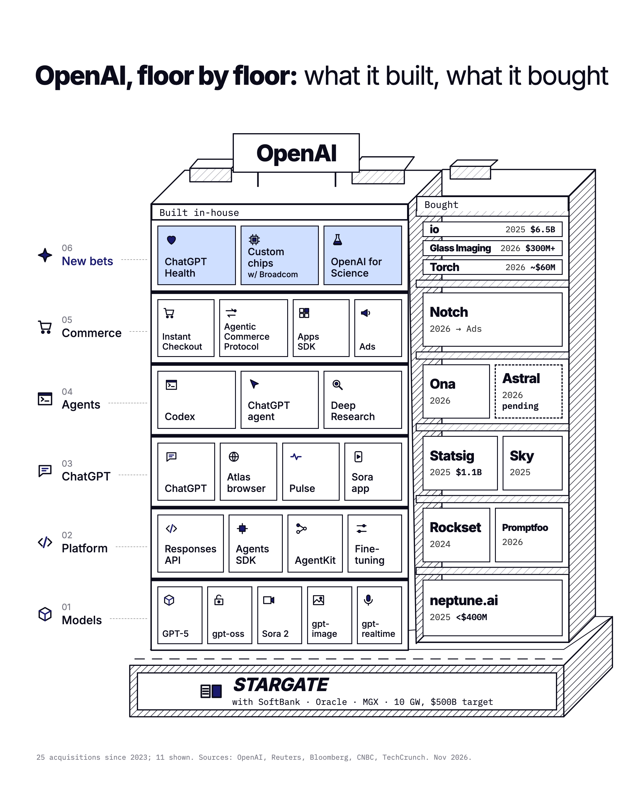

# floor-by-floor

A Claude skill that draws any company as a building. Products it built in-house stack as floors, the companies it bought stand as a second tower, and its infrastructure bet sits in the basement. The output is a 2160x2700 PNG sized for X, plus a matching post.



## Credit

The format comes from **Gap ([@gaspardlezin](https://x.com/gaspardlezin))**, co-founder of [Suby](https://x.com/subyhq), and his post [Stripe, floor by floor: what it built, what it bought](https://x.com/gaspardlezin/status/2118716556117266453). This repo packages that idea so anyone can apply it to another company. Go follow him.

## Install

### npx (any agent that supports skills)

```bash
npx skills add glazec/floor-by-floor
```

This uses the [`skills`](https://github.com/vercel-labs/skills) CLI. It finds `skills/floor-by-floor/SKILL.md` and installs it for Claude Code, Codex, Cursor, and other supported agents. Add `-g` to install globally.

### Manual (Claude Code)

```bash
git clone https://github.com/glazec/floor-by-floor.git
cp -r floor-by-floor/skills/floor-by-floor ~/.claude/skills/
```

### Requirements

- Node 18 or later. There are no npm dependencies.
- Chrome, Chromium, or Edge for the headless screenshot. A non-standard install location can be set with `CHROME_PATH`.
- Network access, because fonts load from Google Fonts.

## Use

Ask your agent:

> Make a floor by floor chart for Anthropic.

The skill walks the agent through these steps:

1. Research built products, acquisitions (with year, price, and status), and the basement bet, with sources.
2. Group the products into 4 to 7 floors, from the core at the bottom to the newest bet at the top, and place each acquisition next to the floor it feeds.
3. Write a JSON data file.
4. Render it: `node skills/floor-by-floor/scripts/render.mjs company.json`
5. Inspect the PNG and fix any overflow.
6. Draft a post in the original's format.

You can also run the renderer yourself on a JSON file:

```bash
node skills/floor-by-floor/scripts/render.mjs examples/openai.json
```

## Example output

[`examples/openai.json`](examples/openai.json) renders to [`examples/openai.png`](examples/openai.png), shown above. The post the skill drafted for it:

```
OpenAI, floor by floor.

> Six floors built in-house, models up to chips and health.
> Below ground: Stargate, $500B with SoftBank, Oracle and MGX.
> On the side: 25 companies bought since 2023.

9 were acqui-hires and most of those apps are gone now. They wanted the people.
```

## Data format

Floors are listed bottom to top. Each floor has `built` products and `bought` items. See [`skills/floor-by-floor/references/data-schema.md`](skills/floor-by-floor/references/data-schema.md) for every field and the icon list.

```json
{
  "company": "Acme",
  "floors": [
    {
      "name": "Core",
      "built": [{ "label": "API", "icon": "code" }],
      "bought": { "items": [{ "name": "Foo", "year": 2025, "value": "$100M" }] }
    },
    {
      "name": "New bets",
      "highlight": true,
      "built": [{ "label": "Robots", "icon": "robot" }],
      "bought": { "items": [{ "name": "Bar", "year": 2026, "pending": true }] }
    }
  ],
  "basement": { "name": "ACME CLOUD", "line": "with Partner · 1 GW" },
  "footer": "Sources: ..."
}
```

## License

MIT. Company names belong to their owners. The chart uses plain text wordmarks, not logos.
